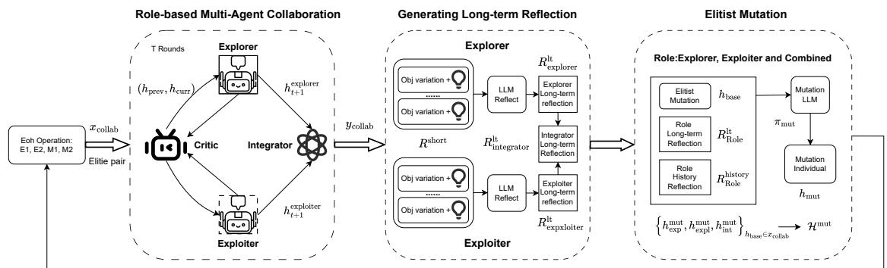
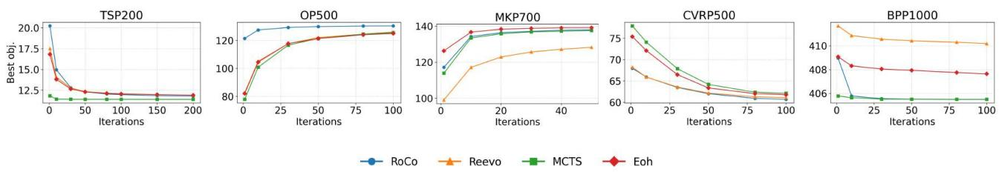
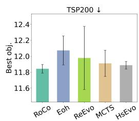
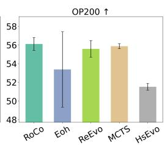
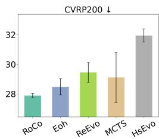
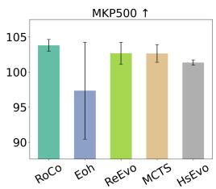
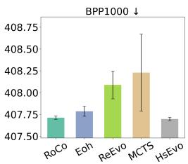

# RoCo: Role-Based LLMs Collaboration for Automatic Heuristic Design

Jiawei Xu $^{1}$ , Fengfeng Wei $^{2}$ , Weineng Chen $^{2}$ ,

$^{1}$ School of Software Engineering, South China University of Technology, Guangzhou, China $^{2}$ School of Computer Science and Engineering, South China University of Technology, Guangzhou, China  
ct20050202@mail.scut.edu.cn, fengfeng\_scut@163.com, cdchenwn@scut.edu.cn

## Abstract

Automatic Heuristic Design (AHD) has gained traction as a promising solution for solving combinatorial optimization problems (COPs). Large Language Models (LLMs) have emerged and become a promising approach to achieving AHD, but current LLM-based AHD research often only considers a single role. This paper proposes RoCo, a novel Multi-Agent Role-Based System, to enhance the diversity and quality of AHD through multi-role collaboration. RoCo coordinates four specialized LLM-guided agents—explorer, exploiter, critic, and integrator—to collaboratively generate high-quality heuristics. The explorer promotes long-term potential through creative, diversity-driven thinking, while the exploiter focuses on short-term improvements via conservative, efficiency-oriented refinements. The critic evaluates the effectiveness of each evolution step and provides targeted feedback and reflection. The integrator synthesizes proposals from the explorer and exploiter, balancing innovation and exploitation to drive overall progress. These agents interact in a structured multi-round process involving feedback, refinement, and elite mutations guided by both short-term and accumulated long-term reflections. We evaluate RoCo on five different COPs under both white-box and black-box settings. Experimental results demonstrate that RoCo achieves superior performance, consistently generating competitive heuristics that outperform existing methods including ReEvo and HSEvo, both in white-box and black-box scenarios. This role-based collaborative paradigm establishes a new standard for robust and high-performing AHD.

## 1 Introduction

Combinatorial optimization problems (COPs) underpin diverse real-world challenges, driving algorithmic innovation in areas such as path planning, electronic design automation (EDA), and manufacturing (Ma et al. 2018; Zebulum, Pacheco, and Vellasco 2018; Zhang et al. 2023a). Despite decades of advances in meta-heuristics, such as iterated local search, simulated annealing, and tabu search, for solving NP-hard combinatorial optimization problems (Mart, Pardalos, and Resende 2018), such design remains a major bottleneck. This process often demands significant domain-specific expertise and extensive trial-and-error, particularly in applications like job scheduling, logistics planning, and robotics (Tan, Mohd-Mokhtar, and Arshad

2021). To address this challenge, Automatic Heuristic Design (AHD) has emerged as a compelling research direction. It seeks to evolve or compose heuristics automatically, reducing reliance on expert-crafted rules. Notable approaches include Genetic Programming (GP)-based methods(Zhang et al. 2023b) and Hyper-Heuristics (HHs) (Pillay and Qu 2018), which operate by searching within predefined heuristic or operator spaces. Recent efforts have explored learning-based improvement heuristics using deep reinforcement learning for routing problems, showing better performance than traditional hand-crafted rules (Wu et al. 2021). However, GP- and HH-based methods remain limited by their reliance on human-defined heuristic spaces, making them less adaptable to novel or black-box tasks. These limitations have driven a new wave of research into more expressive, flexible, and generalizable approaches to automatic heuristic generation.

In recent years, large language models (LLMs), such as GPT-4 (Achiam et al. 2023), have demonstrated impressive capabilities across various reasoning tasks (Hadi et al. 2023), leading to the development of LLM-based automatic heuristic design (AHD) methods that iteratively refine heuristics through evolutionary program search (Liu et al. 2024c; Chen, Dohan, and So 2023). Early works such as FunSearch (Romera-Paredes et al. 2024) and EoH (Liu et al. 2024a) adopt population-based frameworks that evolve heuristic functions using LLMs within fixed algorithmic templates. ReEvo (Ye et al. 2024) enhances heuristic quality through reflection-based reasoning (Shinn et al. 2023), while HSEvo (Dat, Doan, and Binh 2025) introduces diversity metrics and harmony search to improve population diversity. Recent work MCTS-AHD(Zheng et al. 2025) extends this line of research by organizing heuristics in a tree-based structure guided by Monte Carlo Tree Search, enabling structured refinement beyond conventional population-based methods. Together, these methods represent a growing family of LLM-EPS techniques that automate the design of high-quality heuristics for combinatorial and black-box optimization tasks.

Although recent LLM-based approaches to automatic heuristic design (AHD) have demonstrated success in evolving algorithms via population-level or iterative sampling methods, their performance remains unstable when applied to combinatorial optimization problems (COPs), especially in black-box scenarios. These approaches generally employ a single LLM with various prompt strategies, but do not explicitly model distinct agent roles or structured inter-agent coordination. Another relevant effort, LEO (Brahmachary et al. 2025), introduces separate explore and exploit pools to balance diversity and refinement in LLM-driven optimization. However, it lacks explicit role modeling or inter-agent communication, and its performance on complex COPs remains inconsistent. This ultimately limits their ability to adaptively decompose complex tasks or exploit diverse reasoning patterns.

Out of the above consideration, our work draws inspiration from LLM-based Multi-Agent Systems (MAS) (Zhang et al. 2023c; Li et al. 2024), introducing a collaborative agent framework, named RoCo(Role-based LLMs Collaboration), in which LLM-based agents assume specialized roles, such as explorer, exploiter, critic, and integrator, to collectively generate, critique, and refine algorithmic heuristics. Our method extends the population-based architecture of EoH, inheriting its advantages in maintaining heuristic diversity and leveraging population-level selection, while introducing an additional layer of role specialization to enable structured agent-level cooperation. Exploration and exploitation agents generate individuals, critics offer reflection and suggestions, and integrators consolidate the individual outputs of explorers and exploiters to generate new and improved heuristics, balancing exploration and exploitation. This design of critic and integrator is further inspired by multi-agent debate systems (Du et al. 2023a; Liang et al. 2023), where dialogic reasoning and reflective interaction support deep thinking and innovation. However, unlike adversarial debates, our agents engage in cooperative self-improvement, guided by critic feedback, and equipped with short-term (per round) and long-term (cross-round) reflection mechanisms. The long-horizon reflection mechanism is distilled from short-term feedback across rounds, capturing both successful patterns and failed heuristic attempts. Inspired by recent work that highlights the value of learning from exploration failures (An et al. 2023; Song et al. 2024), it enables agents to accumulate insight from both progress and missteps. Such a design leverages both the coordination potential of multi-agent collaboration and the iterative divergence-convergence dynamics of debate, fostering more robust and generalizable heuristic discovery.

In experiments, we apply our approach, RoCo, to five combinatorial optimization problems (COPs) under both white-box and black-box settings. RoCo consistently accelerates the convergence of heuristic search in white-box scenarios and enhances performance stability in black-box scenarios by evolving high-quality heuristics across diverse problem structures.

Our main contributions are as follows: (1) We propose RoCo, a novel LLM-based automatic heuristic design (AHD) framework that introduces role-specialized agents: explorers, exploiters, critics, and integrators, for structured collaboration in generating and refining heuristics. (2) RoCo incorporates coordinated multi-agent interaction and a reflection process that captures both successful strategies and failed heuristic attempts, enabling agents to learn adaptively from mistakes and improve search quality over time.

## 2 Background

## 2.1 COP Formulation

A combinatorial optimization problem (COP) instance is defined as (Zheng et al. 2025):

$$
P = (I _ {P}, S _ {P}, f)\tag{1}
$$

where:

\- $I_P$ : the set of input instances (e.g., coordinates in TSP),

\- $S_{P}$ : the set of feasible solutions,

\- $f: S_P \to \mathbb{R}$ : the objective function to minimize.

A heuristic $h : I_{P} \to S_{P}$ maps an input to a feasible solution. The goal of Automatic Heuristic Design (AHD) is to find the best heuristic $h^{*}$ in a heuristic space H, maximizing the expected performance:

$$
h ^ {*} = \arg \max _ {h \in \mathcal {H}} g (h), \quad g (h) = \mathbb {E} _ {i n s \sim D} \left[ - f (h (i n s)) \right]\tag{2}
$$

## 2.2 LLMs for AHD

LLM-based Evolutionary Program Search (LLM-EPS) integrates large language models into evolutionary computation frameworks to automate the design of heuristics. Representative methods include FunSearch (Romera-Paredes et al. 2024), which adopts an island-based strategy for evolving heuristics in mathematical problems; EoH (Liu et al. 2024a), which applies genetic algorithms with chain-of-thought prompting to improve solutions for tasks like TSP and bin packing; and ReEvo (Ye et al. 2024), which introduces reflective evolution using paired LLMs. More recent approaches like HSEvo (Dat, Doan, and Binh 2025) and MEoh (Yao et al. 2025) explore diversity-driven harmony search with genetic algorithms and multi-objective strategies with dominance-dissimilarity mechanisms, respectively. MCTS-AHD (Zheng et al. 2025) mitigates this by using a tree-based structure to guide LLM exploration more flexibly, while RedAHD (Thach et al. 2025) further enables end-to-end heuristic design by prompting LLMs to construct and refine problem reductions without relying on fixed frameworks. To support the implementation and evaluation of such LLM-EPS methods, LLM4AD has been developed as a unified Python platform, integrating modularized blocks for search methods, algorithm design tasks, and LLM interfaces, along with a unified evaluation sandbox and comprehensive support resources (Liu et al. 2024b).

## 2.3 LLMs-based Multi-Agent System

Recent work on LLM-based Multi-Agent Systems (MAS) has increasingly focused on collaboration mechanisms (Tran et al. 2025; Li et al. 2023; Pan et al. 2024) that facilitate interaction among agents, allowing them to coordinate actions, share information, and solve tasks collectively. Early methods explore fixed interaction patterns such as debate to enhance reasoning (Du et al. 2023b; Liang et al. 2023), while later approaches introduce adaptive communication protocols for multi-round decision-making (Liu et al. 2023).

Other frameworks support broader applications by organizing LLM agents to work jointly on complex problems (Hong et al. 2023; Wu et al. 2024). Our method follows a role-based collaboration protocol (Chen et al. 2023; Talebirad and Nadiri 2023), where agents operate under distinct predefined roles to tackle subgoals modularly and cooperatively (Tran et al. 2025).

## 3 The Proposed RoCo

## 3.1 Role-Based LLM Agent System Definition

To enable effective and scalable AHD, we propose a role-based collaborative system (RoCo) powered by multiple large language model (LLM) agents. This system leverages structured collaboration through clearly defined agent roles, shared memory, and multi-round interaction. Formally, our system is defined as (Tran et al. 2025):

$$
\mathcal {S} = (\mathcal {A}, \mathcal {R}, \mathcal {E}, \mathcal {C}, x _ {\text { collab }}, y _ {\text { collab }})\tag{3}
$$

\- $\mathcal{A} = \{a_i\}_{i=1}^n$ : a set of $n$ LLM-based agents.

\- $\mathcal{R} = \{\text{explorer, exploiter, critic, integrator}\}$ : the predefined set of agent roles.

\- $\mathcal{E}$ : the shared environment (e.g., population pool, reflection history).

\- $\mathcal{C}$ : a set of communication channels among agents.

\- $x_{\text{collab}}$ : the system input (e.g., selected individuals from EoH population).

\- $y_{\text{collab}}$ : the system output (e.g., improved heuristics via collaboration and reflection).

Each agent $a_{i}$ is further characterized by the tuple:

$$
a _ {i} = (L _ {i}, R _ {i}, S _ {i}, T _ {i})\tag{4}
$$

\- $L_{i}$ : the underlying language model (e.g., GPT-4).

\- $R_{i} \in \mathcal{R}$ : the agent's role.

\- $S_{i}$ : agent state, including current individuals and reflection buffer.

\- $T_{i}$ : tools (e.g., Python interpreter).

Finally, the entire system executes collaborative optimization as a function over its inputs and shared environment:

$$
y _ {\text { collab }} = \mathcal {S} (\mathcal {O} _ {\text { collab }}, \mathcal {E}, x _ {\text { collab }} \mid \mathcal {A}, \mathcal {C})\tag{5}
$$

## 3.2 Heuristic Representation

The heuristic representation in RoCo follows the structure of the EoH framework. Each heuristic $h \in H$ is represented as a tuple:

1. A natural language description $\text{desc}(h)$ outlining the core idea of h.

2. A code implementation $\text{code}(h)$ , defined as a Python function that maps an input instance $ins \in I_{P}$ to a feasible solution $h(ins) \in S_{P}$ .

3. A fitness score $g(h)$ , measuring the expected performance of the heuristic across a distribution of instances, as defined in Equation 2.

This structured representation enables seamless integration of newly generated heuristics into the EoH evaluation pipeline, while ensuring compatibility with standard analysis and benchmarking tools.

## 3.3 System Overview of the RoCo framework

Our proposed RoCo system is a multi-agent collaborate-reflection module designed to enhance heuristic generation in the evolutionary framework. As illustrated in Figure 1, RoCo operates as a plug-in system integrated within the Evolution of Heuristics (EoH) paradigm, extending the standard evolutionary loop with collaborative reasoning, structured role division, and multi-agent learning.

At each generation g, the EoH framework maintains a population $P^{g} = \{h_{1}^{g}, h_{2}^{g}, \ldots, h_{N}^{g}\}$ of heuristics. The population is evolved by applying four prompt-based operators, classified into two categories:

\- Exploration Operators (E1, E2): generate heuristics by introducing diversity or combining conceptual patterns from multiple parents.

\- Modification Operators (M1, M2): refine or adjust existing heuristics via mutation or parameter tuning. The details of Eoh operators are exhibited in Appendix E.

This results in a candidate pool of up to 4N new heuristics. Among these, a subset of heuristics is selected and passed to our multi-agent collaboration system S to undergo a structured refinement process.

Formally, two heuristics $h^{(1)}$ and $h^{(2)}$ are sampled from $P^{g}$ and passed as input:

$$
x _ {\text { collab }} = \left(h ^ {(1)}, h ^ {(2)}\right) \in P ^ {g}\tag{6}
$$

The selection of elite individuals follows the strategy described in Appendix E.

The RoCo system then initiates a multi-round collaboration involving agents with distinct functional roles. The output is a set of improved heuristics directly produced from multi-round collaboration, covering different reasoning strategies:

$$
y _ {\text { collab }} = \left\{h _ {g + 1} ^ {\text { explorer }}, h _ {g + 1} ^ {\text { exploiter }}, h _ {g + 1} ^ {\text { integrator }}, \dots \right\}\tag{7}
$$

To construct the next-generation population $P^{g+1}$ , we first gather all heuristics generated by RoCo in generation g, including the collaborative outputs $y_{collab}$ produced during debate and the full set of elite-mutated individuals $H^{mut}$ . These together form the RoCo candidate set:

$$
\mathcal {C} _ {\mathrm{RoCo}} ^ {g + 1} = y _ {\text { collab }} \cup \mathcal {H} ^ {\text { mut }}\tag{8}
$$

We then merge this set with the heuristic pool $P_{eoh}^{g+1}$ generated by standard EoH operators to obtain the full candidate set:

$$
\mathcal {C} _ {\text { full }} ^ {g + 1} = \mathcal {C} _ {\text { RoCo }} ^ {g + 1} \cup P _ {\text { eoh }} ^ {g + 1}\tag{9}
$$

From this combined set, we deterministically select the top N individuals with the best objective values to form the next population:

$$
P ^ {g + 1} = \operatorname{TopN} \left(\mathcal {C} _ {\text { full }} ^ {g + 1}, N\right)\tag{10}
$$

This approach ensures that high-quality heuristics, whether discovered through structured collaboration, memory-driven mutation, or standard evolutionary operators, are retained in the population. The details are shown in Algorithm 1.

  
Figure 1: The architecture of the RoCo system, which integrates multi-agent collaboration into the evolutionary heuristic generation process.

## 3.4 Role Specialization and Agent Design

Each agent in the RoCo system is assigned a specific role to facilitate decomposition of the overall heuristic optimization task into well-defined sub-tasks. The four main roles are:

Explorer Responsible for generating diverse heuristics through conceptual exploration:

$$
h _ {t + 1} ^ {\mathrm{explorer}} = \pi_ {\mathrm{explorer}} \left(h _ {t}, f _ {t} ^ {\mathrm{cri}}\right)\tag{11}
$$

Exploiter Focuses on local improvement by refining promising candidates:

$$
h _ {t + 1} ^ {\mathrm{exploiter}} = \pi_ {\mathrm{exploiter}} \left(h _ {t}, f _ {t} ^ {\mathrm{cri}}\right)\tag{12}
$$

Critic Acts as an evaluator and reflective thinker, identifying strengths and limitations in heuristics and providing structured feedback. Evaluates pair $(h_{\mathrm{prev}}, h_{\mathrm{curr}})$ and gives feedback and reflection:

$$
\left(f _ {t} ^ {\mathrm{cri}}, r _ {t} ^ {\mathrm{cri}}\right) = \pi_ {\text { critic }} \left(h _ {\text { prev }}, h _ {\text { curr }}\right)\tag{13}
$$

Integrator Fuses two candidates with both exploration and exploitation based on their objective scores:

$$
h ^ {\text { int }} = \pi_ {\text { integrator }} \left(h ^ {\text { explorer }}, h ^ {\text { exploiter }}\right)\tag{14}
$$

After all collaborative rounds, it performs elitist fusion of the best-performing explorer and exploiter heuristics. Details are exhibited in Algorithm 1

Each agent $a_{i} = (L_{i}, R_{i}, S_{i}, T_{i})$ operates with its own language model backend $L_{i}$ (e.g., GPT-4), a predefined role $R_{i} \in R$ such as explorer that governs its behavioral policy, an internal state $S_{i}$ containing its current candidate heuristics and optional reflection buffers, and a toolset $T_{i}$ that enables it to evaluate heuristics by executing them and obtaining objective values. The core behavior of each agent is determined by a role-specific policy function $\pi_{role}$ , which guides its reasoning and interactions within a multi-round collaborative loop.

## 3.5 Collaboration and Reflection Mechanisms

RoCo introduces a multi-round collaborative debate process where agents iteratively refine heuristics over T steps. In each round, the critic agent plays a central role by evaluating the most recent heuristic pair and providing feedback, as described in Equation 13.

After T rounds, the accumulated critic reflections $R_{role}^{short}$ are synthesized into long-term role-specific memory by incorporating not only the raw feedback but also the associated objective values and their changes:

$$
R _ {\text { role }} ^ {\text { lt }} = \text { LTReflect } (R _ {\text { role }} ^ {\text { short }}, g _ {t - 1}, g _ {t}, \Delta g _ {t})\tag{15}
$$

Here, $g_{t-1}$ and $g_{t}$ are the objective values before and after the t-th reflection, with $\Delta g_{t} = g_{t} - g_{t-1}$ capturing per-round performance changes. This helps the model infer useful patterns by linking reflection to performance dynamics.

To enable continual learning, each role maintains its own historical memory $R_{role}^{history}$ , formed by aggregating long-term reflections from previous generations. These role-specific historical reflections provide learning signals beyond the current population and enable richer generalization across diverse search states.

Additionally, for integrative reasoning, the long-term reflections from explorer and exploiter can be merged to support integrative generation strategies:

$$
R _ {\text { integrator }} ^ {\mathrm{lt}} = \operatorname{Merge} \left(R _ {\text { explorer }} ^ {\mathrm{lt}}, R _ {\text { exploiter }} ^ {\mathrm{lt}}\right)\tag{16}
$$

To complement collaboration-based generation, RoCo supports a memory-guided elite mutation strategy. For each elite individual $h_{base}$ , three types of memory-augmented mutations are performed:

$$
\begin{array}{l} h _ {\text {exp}} ^ {\text {mut}} = \pi_ {\text {mutation}} ^ {\text {exp}} (h _ {\text {base}}, R _ {\text {explorer}} ^ {\text {lt}}, R _ {\text {explorer}} ^ {\text {history}}) \\ h _ {\text {expl}} ^ {\text {mut}} = \pi_ {\text {mutation}} ^ {\text {expl}} (h _ {\text {base}}, R _ {\text {exploiter}} ^ {\text {lt}}, R _ {\text {exploiter}} ^ {\text {history}}) \\ h _ {\text {int}} ^ {\text {mut}} = \pi_ {\text {mutation}} ^ {\text {int}} (h _ {\text {base}}, R _ {\text {integrator}} ^ {\text {lt}}, R _ {\text {integrator}} ^ {\text {history}}) \end{array}\tag{17}
$$

All resulting mutated individuals from all elite bases are collected into a unified set:

$$
\mathcal {H} ^ {\mathrm{mut}} = \left\{h _ {\mathrm{exp}} ^ {\mathrm{mut}}, h _ {\mathrm{expl}} ^ {\mathrm{mut}}, h _ {\mathrm{int}} ^ {\mathrm{mut}} \right\} _ {h _ {\mathrm{base}} \in x _ {\mathrm{collab}}}\tag{18}
$$

This mechanism mimics a memory-augmented exploitation strategy and supports lifelong learning across generations through diverse role-informed mutations.

  
Figure 2: Evolution curves of different LLM-based AHD methods, plotting the all-time best objective value w.r.t. the number of solution evaluations. The curves, for five datasets (TSP, MKP, OP, BPP, CVRP) each with 1 scales, are averaged over 3 runs with small variances observed.

## 4 Experiments

This section first introduces the experimental setup, including baseline algorithms and implementation details. We then evaluate the proposed method under two metaheuristic frameworks: Ant Colony Optimization (ACO) (Dorigo, Birattari, and Stutzle 2007) and Guided Local Search (GLS) (Arnold and Sörensen 2019), covering a range of combinatorial optimization problems (COPs). Under the ACO framework, we conduct both white-box and black-box evaluations to assess the method's generalization and robustness. In the GLS framework, we further demonstrate the effectiveness of our approach on the Traveling Salesman Problem instances. Finally, ablation studies are presented to analyze the contribution of each system component.

## 4.1 Experimental Setup

Benchmarks: To evaluate the generality and robustness of our approach, we conduct experiments across a suite of combinatorial optimization problems (COPs) spanning multiple structural categories. Specifically, we include: the Traveling Salesman Problem (TSP), Capacitated Vehicle Routing Problem (CVRP), and Orienteering Problem (OP) as representative routing tasks; the Multiple Knapsack Problem (MKP) for subset selection; and the Bin Packing Problem (BPP) for grouping-based challenges. These benchmarks are widely adopted in the COP literature and collectively cover a broad spectrum of algorithmic patterns and difficulty profiles.

Baselines: To assess the effectiveness of our system in generating high-quality heuristics, we compare it against a set of strong baselines. These include several representative LLM-based automatic heuristic design (AHD) approaches such as EoH, ReEvo, and HSEvo, as well as the most recent MCTS-AHD framework. Additionally, we include Deep-ACO (Ye et al. 2023), a neural combinatorial optimization method tailored for ACO frameworks, along with manually designed heuristics, ACO (Dorigo, Birattari, and Stutzle 2007).

Settings: In our RoCo multi-agent system, the number of collaboration rounds is fixed to 3, with a total LLM API budget capped at 400 calls per generation. The underlying EoH framework uses a population size of 10. All experiments are conducted using GPT-4o-mini as the language model. Role-specific temperatures are set as follows: explorer with 1.3, exploiter with 0.8, and default 1.0 for all other roles. Detailed dataset configurations and general framework settings are provided in Appendix D.

## 4.2 Main Results

Heuristic Measures for Ant Colony Optimization(ACO). We first evaluate our RoCo-based heuristic generation system under the Ant Colony Optimization (ACO) framework, a widely adopted paradigm that integrates stochastic solution sampling with pheromone-guided search. Within this framework, our method focuses on designing heuristic functions that estimate the potential of solution components, which are then used to bias the construction of solutions across iterations. We apply this approach to five classic and diverse NP-hard combinatorial optimization problems: TSP, CVRP, OP, MKP, and offline BPP.

Under the white-box prompt setting, we evaluate LLM-based Automatic Heuristic Design (AHD) methods across five COPs. As shown in Table 1, experiments conducted on 64 instances per problem demonstrate that our RoCo method achieves competitive performance. Notably, RoCo outperforms traditional ACO across all problems and surpasses DeepACO in most cases. Compared to other LLM-AHD approaches, RoCo attains the highest scores in 10 out of 15 problem-size combinations, demonstrating its effectiveness for heuristic design in white-box optimization.

As visualized in Figure 2, which plots the evolution of all-time best objective values across diverse problem types and scales, RoCo not only achieves strong final performance but also demonstrates faster convergence across most problem types beyond TSP, where all methods converge similarly. Specifically, in CVRP, MKP, BPP, and OP, RoCo reaches near-optimal performance within fewer iterations compared to baselines, indicating superior sample efficiency. Furthermore, RoCo exhibits robust scalability across problem sizes, consistently maintaining leading or near-leading performance as the instance scale increases—from small to large sizes—across all five combinatorial optimization problems. This highlights RoCo's capacity to generalize its heuristic design abilities across both simple and complex scenarios under white-box prompting conditions.

Under the black-box setting, where LLMs receive only the textual prompt without access to the internal solver state, we evaluate five AHD methods across TSP, OP, CVRP,

Table 1: Designing heuristics with the ACO general framework for solving TSP, OP, CVRP, MKP, and offline BPP under the white-box setting. Each test set contains 64 instances and LLM-based AHD methods' performances are averaged over three runs.

<table><tr><td rowspan="2">Methods</td><td colspan="3">TSP Obj.↓</td><td colspan="3">OP Obj.↑</td><td colspan="3">CVRP Obj.↓</td><td colspan="3">MKP Obj.↑</td><td colspan="3">Offline BPP Obj.↓</td></tr><tr><td>N=50</td><td>N=100</td><td>N=200</td><td>N=50</td><td>N=100</td><td>N=200</td><td>N=50</td><td>N=100</td><td>N=200</td><td>N=100</td><td>N=200</td><td>N=500</td><td>N=500</td><td>N=700</td><td>N=1000</td></tr><tr><td>ACO</td><td>6.064</td><td>9.042</td><td>13.555</td><td>14.981</td><td>29.979</td><td>53.380</td><td>11.623</td><td>19.131</td><td>35.441</td><td>21.673</td><td>42.802</td><td>102.320</td><td>209.132</td><td>291.436</td><td>416.412</td></tr><tr><td>DeepACO</td><td>5.811</td><td>8.186</td><td>11.615</td><td>14.574</td><td>30.474</td><td>55.458</td><td>9.130</td><td>15.242</td><td>27.057</td><td>21.958</td><td>43.170</td><td>102.975</td><td>203.125</td><td>286.685</td><td>406.822</td></tr><tr><td colspan="16">LLM-based AHD: GPT-4o-mini</td></tr><tr><td>Eoh</td><td>5.830</td><td>8.247</td><td>11.771</td><td>15.284</td><td>31.242</td><td>56.320</td><td>9.379</td><td>15.642</td><td>27.801</td><td>23.141</td><td>41.952</td><td>101.472</td><td>204.578</td><td>218.516</td><td>408.672</td></tr><tr><td>ReEvo</td><td>5.770</td><td>8.091</td><td>11.619</td><td>15.267</td><td>31.161</td><td>56.380</td><td>9.095</td><td>15.570</td><td>27.723</td><td>23.039</td><td>41.576</td><td>98.932</td><td>205.141</td><td>287.125</td><td>409.531</td></tr><tr><td>HsEvo</td><td>5.830</td><td>8.315</td><td>12.058</td><td>14.910</td><td>30.414</td><td>54.791</td><td>9.589</td><td>16.426</td><td>29.499</td><td>23.277</td><td>42.454</td><td>102.993</td><td>205.187</td><td>287.063</td><td>409.500</td></tr><tr><td>MCTS-AHD</td><td>5.790</td><td>8.052</td><td>11.380</td><td>15.652</td><td>31.428</td><td>56.205</td><td>9.369</td><td>15.938</td><td>28.375</td><td>23.207</td><td>42.353</td><td>103.110</td><td>202.906</td><td>283.797</td><td>404.734</td></tr><tr><td>RoCo(Ours)</td><td>5.766</td><td>8.115</td><td>11.672</td><td>15.586</td><td>31.653</td><td>57.365</td><td>8.966</td><td>15.148</td><td>27.262</td><td>23.249</td><td>42.479</td><td>103.580</td><td>202.891</td><td>283.734</td><td>404.766</td></tr></table>

Table 2: Designing heuristics with the ACO general framework for solving TSP, OP, CVRP, MKP, and offline BPP under the black-box prompt setting. Each test set contains 64 instances and LLM-based AHD methods' performances are averaged over three runs.

<table><tr><td rowspan="2">Methods</td><td colspan="3">TSP Obj.↓</td><td colspan="3">OP Obj.↑</td><td colspan="3">CVRP Obj.↓</td><td colspan="3">MKP Obj.↑</td><td colspan="3">Offline BPP Obj.↓</td></tr><tr><td>N=50</td><td>N=100</td><td>N=200</td><td>N=50</td><td>N=100</td><td>N=200</td><td>N=50</td><td>N=100</td><td>N=200</td><td>N=100</td><td>N=200</td><td>N=500</td><td>N=500</td><td>N=700</td><td>N=1000</td></tr><tr><td colspan="16">LLM-based AHD: GPT-4o-mini</td></tr><tr><td>Eoh</td><td>5.823</td><td>8.263</td><td>11.885</td><td>15.250</td><td>31.162</td><td>56.364</td><td>9.321</td><td>15.732</td><td>27.881</td><td>23.137</td><td>41.943</td><td>101.556</td><td>204.313</td><td>285.859</td><td>407.719</td></tr><tr><td>ReEvo</td><td>5.767</td><td>8.096</td><td>11.597</td><td>15.238</td><td>31.290</td><td>56.643</td><td>9.472</td><td>16.293</td><td>28.983</td><td>23.318</td><td>42.719</td><td>104.236</td><td>204.203</td><td>285.906</td><td>407.891</td></tr><tr><td>HsEvo</td><td>5.826</td><td>8.286</td><td>11.867</td><td>15.205</td><td>30.589</td><td>51.874</td><td>9.849</td><td>17.455</td><td>31.393</td><td>23.155</td><td>42.022</td><td>101.820</td><td>204.203</td><td>285.844</td><td>407.672</td></tr><tr><td>MCTS-AHD</td><td>5.834</td><td>8.243</td><td>11.785</td><td>15.038</td><td>30.882</td><td>50.887</td><td>9.293</td><td>15.683</td><td>27.805</td><td>23.269</td><td>42.530</td><td>103.781</td><td>204.281</td><td>285.953</td><td>407.781</td></tr><tr><td>RoCo (Ours)</td><td>5.837</td><td>8.244</td><td>11.763</td><td>15.309</td><td>31.239</td><td>56.716</td><td>9.283</td><td>15.706</td><td>27.782</td><td>23.297</td><td>42.637</td><td>104.241</td><td>204.312</td><td>285.734</td><td>407.688</td></tr></table>

MKP, and offline BPP. As shown in Table 2, RoCo achieves strong and stable performance across all problem types and sizes. Notably, RoCo yields the best average results in numerous cases, and performs on par with the best-performing method (ReEvo) in terms of overall heuristic quality. Complementing these results, Figure 3 illustrates the distribution of objective values across multiple runs. RoCo consistently demonstrates smaller standard deviations, indicating enhanced robustness and stability under prompt-only settings. These findings highlight the generality and reliability of RoCo in automatic heuristic design, even under limited-access black-box conditions.

Guided Local Search (GLS). We further evaluate RoCo in the GLS framework by evolving penalty heuristics that guide local search in escaping local optima. Specifically, we embed the best heuristics produced by RoCo into KGLS, a state-of-the-art GLS baseline, and compare its performance (denoted as KGLS-RoCo) against several competitive methods, including NeuOpt (Ma, Cao, and Chee 2023), GN-NGLS (Hudson et al. 2021), EoH (Liu et al. 2024a), and KGLS-ReEvo (Arnold and Sörensen 2019). As shown in Table 4, KGLS-RoCo achieves the lowest average optimality gap on TSP200 and remains highly competitive across other sizes. These results indicate that RoCo can effectively enhance GLS by producing generalizable and high-quality penalty heuristics.

## 4.3 Ablation Studies

To better understand the contribution of each core component in the RoCo framework, we conduct a comprehensive

Table 3: Ablation study of RoCo components on TSP with white-box and black-box prompting.

<table><tr><td>Method</td><td>White box ↓</td><td>Black box ↓</td></tr><tr><td>w/o Explorer</td><td>8.341 ± 0.043</td><td>8.269 ± 0.005</td></tr><tr><td>w/o Exploiter</td><td>8.286 ± 0.049</td><td>8.400 ± 0.103</td></tr><tr><td>w/o Integrator</td><td>8.265 ± 0.039</td><td>8.641 ± 0.428</td></tr><tr><td>w/o Elite Mutation</td><td>8.381 ± 0.080</td><td>8.266 ± 0.016</td></tr><tr><td>w/o MAS</td><td>8.293 ± 0.062</td><td>8.263 ± 0.019</td></tr><tr><td>Collaborate Rounds = 1</td><td>8.333 ± 0.079</td><td>9.341 ± 1.428</td></tr><tr><td>Collaborate Rounds = 2</td><td>8.289 ± 0.067</td><td>8.608 ± 0.512</td></tr><tr><td>Collaborate Rounds = 3</td><td>8.261 ± 0.010</td><td>8.254 ± 0.017</td></tr><tr><td>Collaborate Rounds = 4</td><td>8.275 ± 0.039</td><td>8.277 ± 0.026</td></tr><tr><td>Collaborate Rounds = 5</td><td>8.267 ± 0.036</td><td>8.280 ± 0.027</td></tr><tr><td>RoCo (full)</td><td>8.256 ± 0.023</td><td>8.256 ± 0.014</td></tr><tr><td>EoH (baseline)</td><td>8.257 ± 0.027</td><td>8.327 ± 0.064</td></tr></table>

Specifically, we disable each role or component individually: the explorer agent responsible for conceptual diversity, the exploiter agent focusing on local refinement, the integraablation study on the TSP dataset under both white-box and black-box prompting scenarios. The ablations target the functional roles of key agents (explorer, exploiter, integrator) as well as the elite mutation mechanism and the multi-agent synergy (MAS), comparing each variant against the full RoCo system and the baseline Evolution of Heuristics (EoH). The results are shown in Table 3.

Table 4: Evaluation results of different local search (LS) variants in terms of optimality gaps.

<table><tr><td rowspan="2">Method</td><td rowspan="2">Type</td><td>TSP20</td><td>TSP50</td><td>TSP100</td><td>TSP200</td></tr><tr><td>Opt. gap (%)</td><td>Opt. gap (%)</td><td>Opt. gap (%)</td><td>Opt. gap (%)</td></tr><tr><td>NeuOpt*</td><td>LS+RL</td><td>0.000</td><td>0.000</td><td>0.027</td><td>0.403</td></tr><tr><td>GNNGLS</td><td>GLS+SL</td><td>0.000</td><td>0.052</td><td>0.705</td><td>3.522</td></tr><tr><td>EoH (Liu et al. 2024a)</td><td>GLS+LHH</td><td>0.000</td><td>0.000</td><td>0.025</td><td>0.338</td></tr><tr><td>KGLS</td><td>GLS</td><td>0.004</td><td>0.017</td><td>0.002</td><td>0.284</td></tr><tr><td>KGLS-ReEvo</td><td>GLS+LHH</td><td>0.000</td><td>0.000</td><td>0.000</td><td>0.216</td></tr><tr><td>KGLS-MCTS-AHD</td><td>GLS+LHH</td><td>0.000</td><td>0.000</td><td>0.001</td><td>0.214</td></tr><tr><td>KGLS-RoCo</td><td>GLS+LHH</td><td>0.000</td><td>0.018</td><td>0.001</td><td>0.188</td></tr></table>

$^{\S}$ Results of the first three rows (NeuOpt $^{*}$ , GNNGLS, EoH) are derived from ReEvo (Ye et al. 2024).









  
Figure 3: Heuristic performance evaluation (mean and standard deviation) across diverse datasets (TSP200, OP200, CVRP200, MKP500, BPP1000) under black-box setting, with results aggregated from four independent runs per dataset, using LLM-based AHD.

tor agent for solution fusion, the elite mutation strategy that leverages historical memory, and the MAS mechanism that coordinates collaborative interactions. Each ablated variant is evaluated over multiple runs, and results are reported as mean ± standard deviation of objective values. Notably, the performance drop under the black-box setting is generally more pronounced, indicating that the absence of any single component hampers the system's ability to compensate for limited internal feedback. An additional ablation on MAS further shows that while the memory-guided elite mutation alone can outperform the baseline, it still falls short of the full RoCo system. This demonstrates that role-based collaboration provides additional stability and exploration benefits beyond what is achievable through memory alone, especially in black-box scenarios. This underscores the importance of each role and the necessity of structured role-based collaboration in achieving robust heuristic evolution.

We further investigate the effect of the number of collaboration rounds in RoCo. As shown in Table 3, increasing the number of rounds from 1 to 3 consistently improves performance, particularly under black-box prompting where the gap between single-round and multi-round variants is more pronounced. Extending the ablation to 4 and 5 rounds reveals only marginal gains beyond 3 rounds, confirming that three collaboration rounds achieve an optimal balance between performance and efficiency. This highlights the importance of iterative role interactions for refining heuristic candidates and confirms that multi-round collaboration enhances both robustness and generalization in the RoCo framework.

## 5 Conclusion

This paper presents RoCo, a novel multi-agent role-based system for Automatic Heuristic Design (AHD) that leverages structured collaboration among four specialized LLM-guided agents—explorer, exploiter, critic, and integrator. Integrated into the Evolution of Heuristics (EoH) framework, RoCo enhances heuristic generation through multi-round reasoning, elite mutations, and role-based refinement. Experiments across five combinatorial optimization problems under both white-box and black-box settings demonstrate that RoCo achieves competitive or superior performance compared to state-of-the-art methods. RoCo exhibits faster convergence, better generalization across problem scales, and greater robustness under limited-feedback conditions, setting a new standard for collaborative LLM-based AHD.

Future directions include applying RoCo to more NP-hard problems and other frameworks, beyond combinatorial optimization (e.g., continuous, mixed-integer). Exploring RoCo's potential in real-world applications, such as logistics and scheduling, remains an exciting avenue for practical impact.

## References

Achiam, J.; Adler, S.; Agarwal, S.; Ahmad, L.; Akkaya, I.; Aleman, F. L.; Almeida, D.; Altenschmidt, J.; Altman, S.; Anadkat, S.; et al. 2023. Gpt-4 technical report. arXiv preprint arXiv:2303.08774.

An, S.; Ma, Z.; Lin, Z.; Zheng, N.; Lou, J.-G.; and Chen, W.

2023. Learning from mistakes makes llm better reasoner. arXiv preprint arXiv:2310.20689.

Arnold, F.; and Sörensen, K. 2019. Knowledge-guided local search for the vehicle routing problem. Computers & Operations Research, 105: 32–46.

Brahmachary, S.; Joshi, S. M.; Panda, A.; Koneripalli, K.; Sagotra, A. K.; Patel, H.; Sharma, A.; Jagtap, A. D.; and Kalyanaraman, K. 2025. Large language model-based evolutionary optimizer: Reasoning with elitism. Neurocomputing, 622: 129272.

Chen, A.; Dohan, D.; and So, D. 2023. Evoprompting: Language models for code-level neural architecture search. Advances in neural information processing systems, 36: 7787–7817.

Chen, W.; Su, Y.; Zuo, J.; Yang, C.; Yuan, C.; Qian, C.; Chan, C.-M.; Qin, Y.; Lu, Y.; Xie, R.; et al. 2023. Agentverse: Facilitating multi-agent collaboration and exploring emergent behaviors in agents. arXiv preprint arXiv:2308.10848, 2(4): 6.

Dat, P. V. T.; Doan, L.; and Binh, H. T. T. 2025. Hsevo: Elevating automatic heuristic design with diversity-driven harmony search and genetic algorithm using llms. In Proceedings of the AAAI Conference on Artificial Intelligence, 25, 26931–26938.

Dorigo, M.; Birattari, M.; and Stutzle, T. 2007. Ant colony optimization. IEEE computational intelligence magazine, 1(4): 28–39.

Du, Y.; Li, S.; Torralba, A.; Tenenbaum, J. B.; and Mordatch, I. 2023a. Improving factuality and reasoning in language models through multiagent debate. In Forty-first International Conference on Machine Learning.

Du, Y.; Li, S.; Torralba, A.; Tenenbaum, J. B.; and Mordatch, I. 2023b. Improving factuality and reasoning in language models through multiagent debate. In Forty-first International Conference on Machine Learning.

Hadi, M. U.; Qureshi, R.; Shah, A.; Irfan, M.; Zafar, A.; Shaikh, M. B.; Akhtar, N.; Wu, J.; Mirjalili, S.; et al. 2023. A survey on large language models: Applications, challenges, limitations, and practical usage. Authorea Preprints.

Hong, S.; Zheng, X.; Chen, J.; Cheng, Y.; Wang, J.; Zhang, C.; Wang, Z.; Yau, S. K. S.; Lin, Z.; Zhou, L.; et al. 2023. Metagpt: Meta programming for multi-agent collaborative framework. arXiv preprint arXiv:2308.00352, 3(4): 6.

Hudson, B.; Li, Q.; Malencia, M.; and Prorok, A. 2021. Graph neural network guided local search for the traveling salesperson problem. arXiv preprint arXiv:2110.05291.

Li, H.; Chong, Y. Q.; Steputtis, S.; Campbell, J.; Hughes, D.; Lewis, M.; and Sycara, K. 2023. Theory of mind for multi-agent collaboration via large language models. arXiv preprint arXiv:2310.10701.

Li, X.; Wang, S.; Zeng, S.; Wu, Y.; and Yang, Y. 2024. A survey on LLM-based multi-agent systems: workflow, infrastructure, and challenges. Vicinagearth, 1(1): 9.

Liang, T.; He, Z.; Jiao, W.; Wang, X.; Wang, Y.; Wang, R.; Yang, Y.; Shi, S.; and Tu, Z. 2023. Encouraging divergent thinking in large language models through multi-agent debate. arXiv preprint arXiv:2305.19118.

Liu, F.; Tong, X.; Yuan, M.; Lin, X.; Luo, F.; Wang, Z.; Lu, Z.; and Zhang, Q. 2024a. Evolution of heuristics: Towards efficient automatic algorithm design using large language model. arXiv preprint arXiv:2401.02051.

Liu, F.; Zhang, R.; Xie, Z.; Sun, R.; Li, K.; Lin, X.; Wang, Z.; Lu, Z.; and Zhang, Q. 2024b. Llm4ad: A platform for algorithm design with large language model. arXiv preprint arXiv:2412.17287.

Liu, S.; Chen, C.; Qu, X.; Tang, K.; and Ong, Y.-S. 2024c. Large language models as evolutionary optimizers. In 2024 IEEE Congress on Evolutionary Computation (CEC), 1–8. IEEE.

Liu, Z.; Zhang, Y.; Li, P.; Liu, Y.; and Yang, D. 2023. Dynamic llm-agent network: An llm-agent collaboration framework with agent team optimization. arXiv preprint arXiv:2310.02170.

Ma, Y.; Cao, Z.; and Chee, Y. M. 2023. Learning to search feasible and infeasible regions of routing problems with flexible neural k-opt. Advances in Neural Information Processing Systems, 36: 49555–49578.

Ma, Y.-N.; Gong, Y.-J.; Xiao, C.-F.; Gao, Y.; and Zhang, J. 2018. Path planning for autonomous underwater vehicles: An ant colony algorithm incorporating alarm pheromone. IEEE Transactions on Vehicular Technology, 68(1): 141–154.

Mart, R.; Pardalos, P. M.; and Resende, M. G. 2018. Handbook of heuristics. Springer Publishing Company, Incorporated.

Pan, B.; Lu, J.; Wang, K.; Zheng, L.; Wen, Z.; Feng, Y.; Zhu, M.; and Chen, W. 2024. Agentcoord: Visually exploring coordination strategy for llm-based multi-agent collaboration. arXiv preprint arXiv:2404.11943.

Pillay, N.; and Qu, R. 2018. Hyper-heuristics: theory and applications. Springer.

Romera-Paredes, B.; Barekatain, M.; Novikov, A.; Balog, M.; Kumar, M. P.; Dupont, E.; Ruiz, F. J.; Ellenberg, J. S.; Wang, P.; Fawzi, O.; et al. 2024. Mathematical discoveries from program search with large language models. Nature, 625(7995): 468–475.

Shinn, N.; Cassano, F.; Gopinath, A.; Narasimhan, K.; and Yao, S. 2023. Reflexion: Language agents with verbal reinforcement learning. Advances in Neural Information Processing Systems, 36: 8634–8652.

Song, Y.; Yin, D.; Yue, X.; Huang, J.; Li, S.; and Lin, B. Y. 2024. Trial and error: Exploration-based trajectory optimization for llm agents. arXiv preprint arXiv:2403.02502.

Talebirad, Y.; and Nadiri, A. 2023. Multi-agent collaboration: Harnessing the power of intelligent llm agents. arXiv preprint arXiv:2306.03314.

Tan, C. S.; Mohd-Mokhtar, R.; and Arshad, M. R. 2021. A comprehensive review of coverage path planning in robotics using classical and heuristic algorithms. IEEE Access, 9:119310–119342.

Thach, N.; Riahifar, A.; Huynh, N.; and Chan, H. 2025. RedAHD: Reduction-Based End-to-End Automatic Heuristic Design with Large Language Models. arXiv preprint arXiv:2505.20242.

Tran, K.-T.; Dao, D.; Nguyen, M.-D.; Pham, Q.-V.; O'Sullivan, B.; and Nguyen, H. D. 2025. Multi-agent collaboration mechanisms: A survey of llms. arXiv preprint arXiv:2501.06322.

Wu, Q.; Bansal, G.; Zhang, J.; Wu, Y.; Li, B.; Zhu, E.; Jiang, L.; Zhang, X.; Zhang, S.; Liu, J.; et al. 2024. Autogen: Enabling next-gen LLM applications via multi-agent conversations. In First Conference on Language Modeling.

Wu, Y.; Song, W.; Cao, Z.; Zhang, J.; and Lim, A. 2021. Learning improvement heuristics for solving routing problems. IEEE transactions on neural networks and learning systems, 33(9): 5057–5069.

Yao, S.; Liu, F.; Lin, X.; Lu, Z.; Wang, Z.; and Zhang, Q. 2025. Multi-objective evolution of heuristic using large language model. In Proceedings of the AAAI Conference on Artificial Intelligence, volume 39, 27144–27152.

Ye, H.; Wang, J.; Cao, Z.; Berto, F.; Hua, C.; Kim, H.; Park, J.; and Song, G. 2024. Reevo: Large language models as hyper-heuristics with reflective evolution. Advances in neural information processing systems, 37: 43571–43608.

Ye, H.; Wang, J.; Cao, Z.; Liang, H.; and Li, Y. 2023. Deep-ACO: Neural-enhanced ant systems for combinatorial optimization. Advances in neural information processing systems, 36: 43706–43728.

Zebulum, R. S.; Pacheco, M. A.; and Vellasco, M. M. B. 2018. Evolutionary electronics: automatic design of electronic circuits and systems by genetic algorithms. CRC press.

Zhang, C.; Wu, Y.; Ma, Y.; Song, W.; Le, Z.; Cao, Z.; and Zhang, J. 2023a. A review on learning to solve combinatorial optimisation problems in manufacturing. IET Collaborative Intelligent Manufacturing, 5(1): e12072.

Zhang, F.; Mei, Y.; Nguyen, S.; and Zhang, M. 2023b. Survey on genetic programming and machine learning techniques for heuristic design in job shop scheduling. IEEE Transactions on Evolutionary Computation.

Zhang, J.; Xu, X.; Zhang, N.; Liu, R.; Hooi, B.; and Deng, S. 2023c. Exploring collaboration mechanisms for llm agents: A social psychology view. arXiv preprint arXiv:2310.02124.

Zheng, Z.; Xie, Z.; Wang, Z.; and Hooi, B. 2025. Monte carlo tree search for comprehensive exploration in llm-based automatic heuristic design. arXiv preprint arXiv:2501.08603.

## Appendix

## A RoCo Algorithm Pseudocode

The following pseudocode details the core evolutionary framework of RoCo, including key processes such as population initialization, agent-based heuristic collaboration, memory-guided mutation, and candidate selection for next-generation evolution.

<div class="mineru-algorithm" style="white-space: pre-wrap; font-family:monospace;">
Algorithm 1 RoCo's Evolutionary Framework for Heuristic Population Optimization

Require: Initial population $P^0$ of size $N$

1: for generation $g = 1$ to $G$ do

2: Apply standard EoH operators (E1–M2) to generate $P_{\text{eoh}}^g$

3: Sample elite pair ($h^{(1)}, h^{(2)}$) ⊂ $P^g$

4: Initial critic comparison between elites:

5: ($f_{\text{cri}}^{\text{init}}, r_{\text{cri}}^{\text{init}}$) = $\pi_{\text{critic}}(h^{(1)}, h^{(2)})$

6: Initialize agent states from $h^{(2)}$ with critic feedback:

7: $h_0^{\text{explorer}} = \pi_{\text{explorer}}(h^{(2)}, f_{\text{cri}}^{\text{init}})$

8: $h_0^{\text{exploiter}} = \pi_{\text{exploiter}}(h^{(2)}, f_{\text{cri}}^{\text{init}})$

9: for round $t = 1$ to $T$ do

10: Critic evaluates current heuristics:

11: ($f_t^{\text{cri}}, r_t^{\text{cri}}$) = $\pi_{\text{critic}}(h_{t-1}^{\text{explorer}}, h_{t-1}^{\text{exploiter}})$

12: Explorer proposes new heuristic:

13: $h_t^{\text{explorer}} = \pi_{\text{explorer}}(h_{t-1}^{\text{explorer}}, f_t^{\text{cri}})$

14: Exploiter refines current heuristic:

15: $h_t^{\text{exploiter}} = \pi_{\text{exploiter}}(h_{t-1}^{\text{exploiter}}, f_t^{\text{cri}})$

16: Integrator fuses both heuristics:

17: $h_t^{\text{integrator}} = \pi_{\text{integrator}}(h_t^{\text{explorer}}, h_t^{\text{exploiter}})$

18: end for

19: Identify best heuristics at final round:

20: $\hat{h}_T^{\text{explorer}} = \text{Best}(h_1^{\text{explorer}}, \ldots, h_T^{\text{explorer}})$

21: $\hat{h}_T^{\text{exploiter}} = \text{Best}(h_1^{\text{exploiter}}, \ldots, h_T^{\text{exploiter}})$

22: Perform elite fusion of best heuristics:

23: $\hat{h}_T^{\text{integrator}} = \pi_{\text{integrator}}(\hat{h}_T^{\text{explorer}}, \hat{h}_T^{\text{exploiter}})$

24: Summarize role-specific long-term reflections:

25: $R_{\text{explorer}}^{\text{lt}} = \text{LTReflect}(R_{\text{explorer}}^{\text{short}}, g_{t-1}, g_t, \Delta g_t)$

26: $R_{\text{exploiter}}^{\text{lt}} = \text{LTReflect}(R_{\text{exploiter}}^{\text{short}}, g_{t-1}, g_t, \Delta g_t)$

27: $R_{\text{integrator}}^{\text{lt}} = \text{Merge}(R_{\text{explorer}}^{\text{lt}}, R_{\text{exploiter}}^{\text{lt}})$

28: for each $h_{\text{base}} \in \{h^{(1)}, h^{(2)}\}$ do

29: Memory-guided elite mutations:

30: $h_{\text{exp}}^{\text{mut}} = \pi_{\text{mutation}}^{\text{exp}}(h_{\text{base}}, R_{\text{explorer}}^{\text{lt}})$

31: $h_{\text{expl}}^{\text{mut}} = \pi_{\text{mutation}}^{\text{expl}}(h_{\text{base}}, R_{\text{exploiter}}^{\text{lt}})$

32: $h_{\text{int}}^{\text{mut}} = \pi_{\text{mutation}}^{\text{int}}(h_{\text{base}}, R_{\text{integrator}}^{\text{lt}})$

33: end for

34: Construct RoCo candidate set:

35: $H^{\text{mut}} = \left\{ h_{\text{exp}}^{\text{mut}}, h_{\text{expl}}^{\text{mut}}, h_{\text{int}}^{\text{mut}} \right\}$

36: $y_{\text{collab}} = \left\{ h_T^{\text{explorer}}, h_T^{\text{exploiter}}, h_T^{\text{integrator}} \right\}$

37: $C_{\text{RoCo}}^{g+1} = y_{\text{collab}} \cup H^{\text{mut}} \cup \left\{ \hat{h}_T^{\text{integrator}} \right\}$

38: Merge with standard EoH outputs:

39: $C_{\text{full}}^{g+1} = C_{\text{RoCo}}^{g+1} \cup P_{\text{eoh}}^g$

40: Select top-N heuristics for next generation:

41: $P^{g+1} = \text{TopN}(C_{\text{full}}^{g+1}, N)$

42: end for
</div>

## B Benchmark Problems

## Traveling Salesman Problem

The Traveling Salesman Problem (TSP) is a classic optimization challenge that seeks the shortest possible route for a salesman to visit each city in a list exactly once and return to the origin city. As one of the most representative combinatorial optimization problems (COPs), synthetic TSP instances for our experiments are constructed by sampling nodes uniformly from the $[0,1]^{2}$ unit square, following the dataset generation protocol described in ReEvo (Ye et al. 2024).

## Capacitated Vehicle Routing Problem

The Capacitated Vehicle Routing Problem (CVRP) extends the Traveling Salesman Problem (TSP) by introducing capacity constraints on vehicles. It aims to plan routes for multiple capacity-limited vehicles (starting and ending at a depot) to satisfy customer demands while minimizing total travel distance. For experimental instances: Across experiments, the depot is fixed at the unit square center (0.5, 0.5), following the dataset generation protocol of ReEvo (Ye et al. 2024).

## Orienteering Problem

The Orienteering Problem (OP) aims to maximize the total collected score by visiting a subset of nodes within a limited tour length constraint. Following the dataset generation strategy of Ye et al. (2024, 2023), we uniformly sample all nodes, including the depot, from the unit square $[0,1]^{2}$ . The prize $p_{i}$ associated with each node i is set according to a challenging distribution:

$$
p _ {i} = \frac {1 + \frac {j}{9 9} \cdot \left(\frac {d _ {0 i}}{\max _ {j = 1} ^ {n} d _ {0 j}}\right) ^ {k}}{1 0 0},
$$

where $d_{0i}$ denotes the Euclidean distance from the depot to node i, and k is a fixed scaling parameter. The tour length constraint is also designed to be challenging, with the maximum length set to 3, 4, 5, 8, and 12 for OP50, OP100, OP200, OP500, and OP1000, respectively.

## Multiple Knapsack Problem

The Multiple Knapsack Problem (MKP) involves assigning items (each with a weight and value) to multiple knapsacks to maximize total value, without exceeding any knapsack's capacity. For instance generation, we follow ReEvo (Ye et al. 2024): item values $v_{i}$ and weights $w_{ij}$ (for item $j$ and knapsack $i$ ) are uniformly sampled from [0, 1], and each knapsack's capacity $C_{i}$ is drawn from $(\max_{j} w_{ij}, \sum_{j} w_{ij})$ to ensure valid instances.

## Offline Bin Packing Problem

The Offline Bin Packing Problem (Offline BPP) aims to pack a set of items with known sizes into the minimum number of bins of fixed capacity W, where all items are available for assignment upfront. For instance generation, we follow ReEvo (Ye et al. 2024): bin capacity is set to W = 150, and item sizes are uniformly sampled from $[20, 100]$ .

## C Detailed General Framework

## Guided Local Search

Guided Local Search (GLS) explores the solution space via local search operations, where heuristics guide the exploration process. Following the setup in ReEvo (Ye et al. 2024), we adopt a modified GLS algorithm that incorporates perturbation phases: edges with higher heuristic values are prioritized for generalization (Arnold and Sörensen 2019).

In the training phase, we evaluate candidate heuristics on the TSP200 instance using 1200 GLS iterations. For generating results in our experiments (e.g., Table 4), we use the GLS parameters specified in Table 5 (consistent with ReEvo). Iterations terminate when a predefined threshold is reached or the optimality gap is reduced to zero.

Table 5: GLS parameters used for the evaluations in Table 1.

<table><tr><td>Problem</td><td>Perturbation moves</td><td>Number of iterations</td><td>Scale parameter λ</td></tr><tr><td>TSP20</td><td>5</td><td>73</td><td></td></tr><tr><td>TSP50</td><td>30</td><td>175</td><td rowspan="2">0.1</td></tr><tr><td>TSP100</td><td>40</td><td>1800</td></tr><tr><td>TSP200</td><td>40</td><td>800</td><td></td></tr></table>

## Heuristic measures for Ant Colony Optimization

Ant Colony Optimization (ACO) is a meta-heuristic evolutionary algorithm inspired by ants' foraging behavior, designed to solve combinatorial optimization problems (Dorigo, Birattari, and Stutzle 2007). ACO operates via two core matrices:

\- Pheromone matrix $\pmb{\tau}$ : $\tau_{ij}$ reflects the priority of edge $(i,j)$ , iteratively updated based on solution quality to direct searches toward promising areas.

\- Heuristic matrix $\eta$ : $\eta_{ij}$ encodes problem-specific immediate benefits (e.g., $\eta_{ij} = 1 / d_{ij}$ for TSP, where $d_{ij}$ is the inter-city distance).

Ants construct solutions by probabilistically selecting next nodes using a combination of pheromone and heuristic information. A complete ACO iteration includes solution construction, optional local search, and pheromone trail update, enabling convergence to near-optimal solutions for NP-hard problems. Following ReEvo (Ye et al. 2024), we use ACO as a baseline framework where LLMs search for optimal heuristics to guide pheromone-informed sampling. For experimental settings in Table 1 and Table 2, we follow the protocols defined in MCTS-AHD (Zheng et al. 2025), which will be shown in Table 6.

Table 6: ACO parameters for heuristic evaluations. Evaluation phase corresponds to Figure 2, and testing phase corresponds to Table 1 and Table 2.

<table><tr><td>Problem</td><td>Population size</td><td>Number of iterations when evaluation</td><td>Number of iterations when testing</td></tr><tr><td>TSP</td><td>30</td><td>200</td><td>500</td></tr><tr><td>OP</td><td>30</td><td>100</td><td>200</td></tr><tr><td>CVRP</td><td>20</td><td>100</td><td>500</td></tr><tr><td>MKP</td><td>10</td><td>50</td><td>100</td></tr><tr><td>BPP</td><td>20</td><td>100</td><td>100</td></tr></table>

## D Detailed Evaluations and Experiments

In this section, we elaborate on the configuration of the evaluation budgets T and evaluation datasets in different phase. Evaluation settings are generally adopted from early work, including ReEvo (Ye et al. 2024), MCTS-AHD (Zheng et al. 2025).

The settings of $T$ In experiments, all baselines and RoCo have a maximum of 400 evaluations, with a population size of 10 across all datasets. For initial population sizes: ReEvo, HSEvo, and RoCo are 30; Eoh's initial population size matches its population size (consistent with the paper's settings); MCTS is 4, as in the original paper.

The settings of training phase and testing phase evaluation dataset In the training and the testing phase, for all tasks, RoCo follows the same settings in LLM-based AHD methods, such as ReEvo (Ye et al. 2024) and MCTS (Zheng et al. 2025). For detailed information about the training and testing datasets used across different tasks and frameworks, please refer to Table 7. In the training phase, The running time of each heuristic on the training dataset is limited to 60 seconds except CVRP. The limit time for CVRP is 120 seconds.

White-box and Black-box Settings For completeness, we additionally evaluate RoCo and all baselines under both white-box and black-box settings, following recent LLM-based heuristic design protocols.

In the white-box setting, the full problem structure is explicitly exposed to the LLM. For routing problems such as TSP and CVRP, the distance matrix is directly included in the prompt, enabling explicit pairwise-distance reasoning. In contrast, the black-box setting restricts structural access: distances are encoded only as abstract edge attributes of shape $(n_{\text{edges}}, 1)$ , and prompts cannot access the global structural information. Both prompt templates will be shown in the camera-ready appendix for clarity.

## E Detailed Methodology

## Eoh Details

In the RoCo system, which is built upon the EoH framework, we adopt four key evolutionary prompt strategies to create new heuristics. These strategies are inspired by human heuristic development behaviors and are categorized into two main types: Exploration and Modification. The exploration strategies (E1, E2) are designed to diversify the heuristic space, while the modification strategies (M1, M2) aim to refine and improve existing heuristics. Below, we describe each strategy in detail.

E1: Dissimilarity-based Exploration. This strategy encourages the generation of novel heuristics that significantly differ from existing ones. Given a set of p heuristics selected from the current population, the LLM is instructed to design a new heuristic that deviates as much as possible from the selected ones. This helps broaden the search space and introduces innovative ideas that are not present in the current population.

Table 7: Training and testing datasets used for different tasks and frameworks.

<table><tr><td>Framework</td><td>ACO</td><td>ACO</td></tr><tr><td>Task</td><td>TSP</td><td>OP</td></tr><tr><td>Training dataset</td><td>5 50-node TSP instances</td><td>5 50-node OP instances</td></tr><tr><td>Testing dataset</td><td>64 50,100,200-node TSP instances</td><td>64 50,100,200,500-node OP instances</td></tr><tr><td>Framework</td><td>ACO</td><td>ACO</td></tr><tr><td>Task</td><td>CVRP</td><td>MKP</td></tr><tr><td>Training dataset</td><td>10 50-node CVRP instances</td><td>5 100-item MKP instances (m=5)</td></tr><tr><td>Testing dataset</td><td>64 50,100,200,500-node CVRP instances</td><td>64 100,200,300,500,700-item MKP instances</td></tr><tr><td>Framework</td><td>ACO</td><td>GLS</td></tr><tr><td>Task</td><td>Offline BPP</td><td>TSP</td></tr><tr><td>Training dataset</td><td>5 500-item BPP instances</td><td>10 200-node TSP instances</td></tr><tr><td>Testing dataset</td><td>64 500,700,1000-item BPP instances</td><td>64 50,100,200-node TSP instances</td></tr></table>

E2: Idea-based Exploration. Unlike E1, this strategy maintains some conceptual consistency with existing heuristics while still aiming for novelty. The LLM is first prompted to identify shared underlying ideas among p selected parent heuristics. It is then asked to generate a new heuristic that builds on these shared principles but introduces new structures or components, thereby maintaining relevance while encouraging creative recombination.

M1: Structural Modification. This strategy directly modifies a single existing heuristic to potentially improve its performance. The LLM is provided with one selected heuristic and prompted to produce a revised version that addresses weaknesses, removes redundancy, or enhances specific parts. This type of local modification supports efficient exploitation in the search space.

M2: Parameter Adjustment. This strategy targets the internal parameters of a given heuristic rather than its overall structure. The LLM is instructed to keep the general logic of the selected heuristic but experiment with different parameter settings. This allows for fine-tuning heuristics while preserving their core behaviors.

These strategies collectively guide the generation of new heuristics in each evolution step. By combining exploration and refinement, the system balances novelty and quality, leading to more effective heuristic discovery over time.

## Methods for Choosing Elite Individuals from Population

To construct the collaborative pair $x_{\mathrm{collab}} = (h^{(1)}, h^{(2)})$ , we employ a \*\*probability-based selection strategy\*\* to choose two elite individuals from the current population. The selection process is described as follows:

Given a population of size N, we define a decreasing probability distribution over the individuals, where top-ranked individuals are more likely to be selected. Specifically, the selection probability $p_{i}$ for the i-th individual is:

$$
p _ {i} = \frac {1}{(i + 1) ^ {k}} / \sum_ {j = 0} ^ {N - 1} \frac {1}{(j + 1) ^ {k}}
$$

where k = 3.0 is the power coefficient controlling the decay rate of selection preference, favoring top performers while preserving diversity.

The first selected index is sampled from this distribution. The second selected index is then chosen as either the first index + 1 or + 2 (within bounds), ensuring it is greater than the first index and the two individuals are distinct and adjacent in rank. Minimal checks enforce valid ranges, with resampling or defaults applied for edge cases as needed.

This mechanism ensures collaborative pairs are high-quality (elite-biased) and structurally adjacent, promoting meaningful hybridization in subsequent fusion steps.

## Prompts of RoCo

```txt
{task_description}
Here is an algorithm proposed by previous agents:
Algorithm description: {alg_description}
Code: {code}
Objective score: {obj}
Critic's feedback: {cri_response}
Reflection: {reflection}
Based on the critic's feedback and the reflection, please propose a new algorithm that improves the previous ones focusing on global diversity and long-term potential. Use creative, future-oriented thinking to introduce novel directions combined with critic's feedback.
```

```txt
{output_request}
```

## Prompt 1: The prompt of explorer.

```txt
{task_description}
Here are some algorithms proposed by previous agents:
Algorithm description: {alg_description}
Code: {code}
Objective score: {obj}
Critic's feedback: {cri_response}
Reflection: {reflection}
Based on the critic's feedback and the reflection, please propose a new algorithm that improves the previous ones to refine and improve it through short-term gains and local optimizations. Use conservative, efficiency-driven thinking to enhance performance incrementally.
{output_request}
```

## Prompt 2: The prompt of exploiter.

```txt
{task_description}
Here are the current candidates for integration:
Explorer's algorithm description: {explorer_algorithm}
Explorer's code: {explorer_code}
Explorer's objective Score: {explorer_obj}

Exploiter's algorithm description: {exploiter_algorithm}
Exploiter's code: {exploiter_code}
Exploiter's objective Score: {exploiter_obj}

Act as a strategic integrator. Weigh the long-term innovation of the explorer, the short-term refinement of the exploiter. Remember A lower objective score is better.
Propose the next step that balances exploration and exploitation, maximizing overall progress by reasoning through their complementary strengths.
{output_request}
```

## Prompt 3: The prompt of integrator.

```txt
{task_description}
Here are the BEST candidates for integration:
Best explorer's code:{explorer_code}
objective Score: {explorer_obj}

Best exploiter's code:{exploiter_code}
objective Score: {exploiter_obj}

Reflection summary: {summary}
Act as a strategic integrator. You must consider:
1. The long-term innovation potential from the best explorer
2. The short-term refinement capabilities from the best exploiter
3. Insights from the reflection summary
Your task is to create a solution that combines the strongest elements from both algorithms while addressing insights from the reflection. Create an algorithm that balances exploration and exploitation to maximize progress.
{output_request}
```  
Prompt 4: The prompt of final elite integrator.

```txt
{task_description}
Here are the algorithms proposed by initial population.
Better code:
{first_code}
Better objective score: {first_objective}
Worse code:
```

```txt
{second_code}
Worse objective score: {second_objective}
Note: **A lower objective score is better**.

Act as a reflector and critical evaluator in the domain of optimization heuristics. First, reflect on why the better algorithm outperforms the other: You respond with some hints for designing better heuristics, based on the two code and using less than 20 words. Then analyze the worse algorithm's limitations and provide specific, actionable improvements.

Please provide your answer in the following format:
<ref>Reflection on current code's evolution direction (max 30 words)</ref>
<ans>Specific critique and actionable suggestions (max 40 words)</ans>
Let's think step by step and be constructive in your analysis.
```  
Prompt 5: The prompt of initial critic.

```txt
{task_description}
As an optimization expert in the domain of heuristic optimization, compare:
Worse algorithm description: {first_alg}
Worse and prior code: {first_code}
Worse objective value: {first_obj}
Better algorithm description: {second_alg}
Better and current code: {second_code}
Better objective value: {second_obj}

First, consider and reflect on the evolution direction of the current code:
**Note: current code is worse**: Why did this evolution direction fail? What design choices or implementation changes were counterproductive? Such as "avoid..." and so on.
{invalid_ind_prompt}

Then provide targeted feedback for the current code: For the current worse code: Suggest how to correct the evolution path
Format your response as:
<ref>Your reflection about current code</ref> <ans>Specific critique and actionable suggestions (max 40 words)</ans>
Let's think step by step and be constructive in your analysis.
```

## Prompt 6: The prompt of critic when current individual is better than previous one.

```txt
{task_description}
As an optimization expert in the domain of heuristic optimization, compare:
Worse algorithm description: {first_alg}
Worse and prior code: {first_code}
Worse objective value: {first_obj}
Better algorithm description: {second_alg}
Better and current code: {second_code}
Better objective value: {second_obj}

First, consider and reflect on the evolution direction of the current code:
**Note: current code is worse**: Why did this evolution direction fail? What design choices or implementation changes were counterproductive? Such as "avoid..." and so on.
{invalid_ind_prompt}

Then provide targeted feedback for the current code: For the current worse code: Suggest how to correct the evolution path
Format your response as:
<ref>Your reflection about current code</ref> <ans>Specific critique and actionable suggestions (max 40 words)</ans>
Let's think step by step and be constructive in your analysis.
```  
Prompt 7: The prompt of critic when current individual is worse than previous one.

```txt
{task_description}
As an optimization expert in the domain of heuristic optimization, compare:
Worse algorithm description: {first_alg}
Worse and prior code: {first_code}
Worse objective value: {first_obj}
Better algorithm description: {second_alg}
Better and current code: {second_code}
Better objective value: {second_obj}

First reflect on the evolution direction of the current code: (Note: Current code is better)
What successful evolutionary patterns can we identify? Which design improvements were
most effective? Such as "..benefits", "..gains" and so on. {invalid_ind_prompt}

Then provide targeted feedback for the current code: Recommend how to further leverage
successful strategies.
Format your response as:
<ref>Your reflection about current code</ref> <ans>Specific critique and actionable
suggestions (max 40 words)</ans>
Let's think step by step and be constructive in your analysis.
```

Prompt 8: The prompt ofritic when current individual is better than previous one.

```txt
Below is your prior short-term reflection on designing heuristics for {task_description}
{reflection}
Based on the relection with changing of the objective scores for {role} {role_description},
write constructive and detailed hints for designing better heuristics, based on prior reflections and focus on {role} and using less than 50 words. Please provide your answer in the following format: <ans>...</ans>. Let's think step by step.
```

Prompt 9: The prompt of long-term reflector.

```txt
{task_description}
[History reflection as reference]:
{history_reflection}
[Reflection insights]:
{reflection}
[Current best code]:
{elitist_code}
Based on the history reflections and mainly based on reflection insights and the current best code, propose a mutation that addresses the key insights and improves upon the previous solutions.
{output_request}
```

Prompt 10: The prompt of elite mutation.

## F Code for Best Heuristics

This section presents the best heuristics generated by RoCo for all problem settings, including both white-box and black-box settings.

```python
def heuristics_v2(distance_matrix):
    num_nodes = distance_matrix.shape[0]
    heuristics_matrix = np.zeros((num_nodes, num_nodes))

    for i in range(num_nodes):
    for j in range(num_nodes):
    if i != j:
    # Modified connection score with increased penalty for high-degree nodes
    degree_penalty = np.sum(distance_matrix[j] < distance_matrix[i]) + 2  # Higher penalty
    distance_score = 1 / (distance_matrix[i][j] ** 3)  # Modified distance scoring
    heuristics_matrix[i][j] = distance_score / degree_penalty
```

```txt
# Normalize the heuristics matrix
heuristic_sum = np.sum(heuristics_matrix, axis=1, keepdims=True)
heuristics_matrix = heuristics_matrix / heuristic_sum
return heuristics_matrix
```

Heuristic 11: RoCo's Best Heuristic for white-box TSP

```python
def heuristics_v2(edge_attr: np.ndarray) -> np.ndarray:
    min_attr = np.min(edge_attr)
    max_attr = np.max(edge_attr)
    range_attr = max_attr - min_attr

# Polynomial transformation
polynomial_attr = np.power(edge_attr - min_attr, 2) # Using square transformation

# Simplified hybrid scaling technique
scaled_attr = (polynomial_attr - np.min(polynomial_attr)) / (range_attr + 1e-10)

# Weighted hybrid mean capturing edge attribute diversity
weighted_mean = np.mean(polynomial_attr)
heuristics_matrix = (weighted_mean / (scaled_attr + 1e-10)) ** 2 # Prioritize lower attributes

return heuristics_matrix.flatten() # Return as a 1D array
```

Heuristic 12: RoCo's Best Heuristic for black-box TSP

```python
def heuristics(prize, distance, maxlen):
    n = len(prize)
heuristics_matrix = np.zeros((n, n))

for i in range(n):
    prize_distance_ratios = []
    for j in range(n):
    if i != j and distance[i][j] <= maxlen:
    ratio = prize[j] / distance[i][j]
    exponential_ratio = np.exp(prize[j] / distance[i][j])
    combined_score = 0.5 * ratio + 0.5 * exponential_ratio # Equal weight to both ratios
    prize_distance_ratios.append((j, combined_score))

    # Sort nodes by the combined score in descending order
    prize_distance_ratios.sort(key=lambda x: x[1], reverse=True)

    # Calculate cumulative promise while respecting maxlen
    accumulated_distance = 0
    for j, score in prize_distance_ratios:
    if accumulated_distance + distance[i][j] <= maxlen:
    heuristics_matrix[i][j] = score
    accumulated_distance += distance[i][j]

return heuristics_matrix
```

Heuristic 13: RoCo's Best Heuristic for white-box OP

```python
def heuristics_v2(node_attr, edge_attr, node_constraint):
    n = len(node_attr)
    heuristics_matrix = np.zeros((n, n))

    special_node_attr = node_attr[0]  # Attribute of the special node indexed by 0
    # Initialize adaptive thresholds based on a new factor
```

```python
edge_threshold = np.maximum(edge_attr.sum(axis=0) * 0.7, node_constraint) # New threshold adjustment factor
score_history = np.zeros(n) # to store history of scores for feedback mechanism
fixed_weight = 0.25 # Adjusted fixed weight for scoring

for i in range(1, n):
    for j in range(n):
    if i != j: # Skip self-loops
    edge_sum = edge_attr[i, j]
    if edge_sum > 0 and edge_sum <= edge_threshold[j]:
    connection_diversity = np.sum(edge_attr[i] > 0)
    diversity_contribution = (special_node_attr * node_attr[j] *
    connection_diversity) / (edge_sum ** 2 + 1e-10)

    # Introduce modified fixed weight into score calculation
    weighted_score = fixed_weight * (node_attr[j] ** 2) / (edge_sum + 1e-10)
    score = diversity_contribution * (weighted_score * (node_constraint / (edge_sum + 1e-10)))

    # Update thresholds based on previous scores with adjustments for sensitivity
    edge_threshold[j] = max(edge_threshold[j], score / (1 + score_history[j] ** 0.5)) # dynamic adjustment with sensitivity

    # Ensure non-negativity and log scores for feedback mechanism
    heuristics_matrix[i, j] = max(0, score)
    score_history[j] = score # Store the latest score

return heuristics_matrix
```

Heuristic 14: RoCo's Best Heuristic for black-box OP

```python
def heuristic_v2(distance_matrix, coordinates, demands, capacity):
    n = distance_matrix.shape[0]
    heuristics_matrix = np.zeros((n, n))

    historical_performance = np.ones((n, n))
    total_edge_visits = np.zeros((n, n))

    learning_rate = 0.3
    regularization_term = 0.01

    for i in range(1, n):
    for j in range(1, n):
    if i != j:
    total_demand = demands[i] + demands[j]

    distance_score = 1 / (distance_matrix[i, j] ** 2 + 1e-5) # Reduced emphasis on proximity
    proximity_score = 1 / (np.linalg.norm(coordinates[i] - coordinates[j]) ** 2 + 1e-5)

    if total_demand <= capacity:
    edge_score = distance_score * proximity_score *
    historical_performance[i, j]
    else:
    dynamic_penalty = (total_demand ** 2) / (capacity + 1e-5) # Heavier penalty for high demand
    edge_score = (distance_score * proximity_score *
    historical_performance[i, j]) / dynamic_penalty

    # Adjusting clustering factor to consider only higher than average demand
    avg_demand = np.mean(demands[1:])
    clustering_factor = sum(demands[k] for k in range(1, n) if demands[k] > avg_demand and np.linalg.norm(coordinates[k] - coordinates[i]) <
```

```python
np.linalg.norm(coordinates[k] - coordinates[j])) / max(avg_demand, 1e-5)
edge_score *= (1 + clustering_factor)

decay_factor = 1 / (1 + total_edge_visits[i, j])
historical_performance[i, j] = (1 - learning_rate) *
    historical_performance[i, j] + learning_rate * edge_score
historical_performance[i, j] = historical_performance[i, j] / (1 + regularization_term * total_edge_visits[i, j])

total_edge_visits[i, j] += 1

heuristics_matrix[i, j] = edge_score

return heuristics_matrix
```

Heuristic 15: RoCo's Best Heuristic for white-box CVRP

```python
def heuristics(edge_attr, node_attr):
    import numpy as np

    n = edge_attr.shape[0]
    heuristics_matrix = np.zeros_like(edge_attr)

    normalization_factor = np.power(node_attr, 1/3)
    adaptive_weights = np.ones_like(edge_attr)

    max_iterations = 100
    tolerance = 1e-5
    exploration_factor = 0.1
    damping_factor = 0.8 # Damping factor to mitigate oscillations

    previous_heuristics_matrix = np.copy(heuristics_matrix)

    for iteration in range(max_iterations):
    for i in range(n):
    for j in range(n):
    if edge_attr[i, j] != 0:
    heuristics_matrix[i, j] = (normalization_factor[i] * normalization_factor[j]) / (edge_attr[i, j] ** 2)
    adaptive_weights[i, j] = damping_factor * adaptive_weights[i, j] + (1 - damping_factor) * heuristics_matrix[i, j]

    heuristics_matrix *= adaptive_weights

    # Calculate mean and std deviation for adaptive weight adjustments
    positive_heuristics = heuristics_matrix[heuristics_matrix > 0]
    if len(positive_heuristics) > 0:
    mean_heuristics = np.mean(positive_heuristics)
    std_dev = np.std(positive_heuristics)

    for i in range(n):
    for j in range(n):
    if edge_attr[i, j] != 0:
    adaptive_weights[i, j] = np.clip(adaptive_weights[i, j] + 0.01 * (mean_heuristics - std_dev), 0, None)

    if np.max(np.abs(heuristics_matrix - previous_heuristics_matrix)) < tolerance:
    break

    previous_heuristics_matrix = np.copy(heuristics_matrix)

    return heuristics_matrix
```

Heuristic 16: RoCo's Best Heuristic for black-box CVRP

```python
def heuristics_reevo(prize, weight):
    n = len(prize)
    m = weight.shape[1]
    heuristics_matrix = np.zeros(n)

    global_average = np.mean(prize)
    performance_metrics = np.zeros(n)  # Track performance of selections
    selection_counts = np.zeros(n)  # Track the number of selections made
    temperature = 1.0  # Initial temperature for exploration
    max_iterations = 100  # Maximum iterations for the process
    iteration = 0  # Current iteration
    reset_threshold = 20  # Periodic reset interval
    synergy_matrix = np.zeros((n, n))  # Store synergy potential between items

    while iteration < max_iterations:
    for i in range(n):
    max_weight = np.max(weight[i])
    if max_weight > 0:
    efficiency_score = prize[i] / max_weight  # Efficiency of prize-to-weight ratio
    diversity_factor = 1 / (1 + np.abs(prize[i] - global_average))  # Encourages diversity

    # Update performance metrics
    if selection_counts[i] > 0:
    performance_metrics[i] = (performance_metrics[i] * 0.5 +
    efficiency_score * 0.5)
    else:
    performance_metrics[i] = efficiency_score

    # Synergy potential computation with diversity weighting
    for j in range(n):
    if i != j:
    synergy_weight = np.exp(-np.abs(weight[i] - weight[j]).sum())  # High synergy if weights are similar
    synergy_matrix[i][j] = synergy_weight * (1 + 0.5 * np.abs(prize[i] - prize[j]) / (np.max(prize) - np.min(prize)))

    # Calculate total synergy score with normalization
    total_synergy = np.sum(synergy_matrix[i]) / (n - 1)  # Normalize
    heuristics_matrix[i] = efficiency_score * diversity_factor *
    performance_metrics[i] * total_synergy

    # Dynamic exploration-exploitation balancing
    adaptive_exploration_probability = 1 / (1 + selection_counts[i] * temperature)
    if np.random.rand() < adaptive_exploration_probability:
    selection_counts[i] += 1

    # Periodic exploration reset
    if iteration % reset_threshold == 0 and iteration > 0:
    performance_metrics = np.zeros(n)  # Reset performance metrics to enhance exploration

    # Temperature decay adjustment
    average_performance = np.mean(performance_metrics) + 0.1  # Update based on performance
    temperature = max(0.1, temperature * (0.99 + 0.01 * average_performance))  # Gradually decay temperature

    iteration += 1

return heuristics_matrix
```

## Heuristic 17: RoCo's Best Heuristic for white-box MKP

```python
def heuristics_v2(item_attr1, item_attr2):
    n = len(item_attr1)
    m = item_attr2.shape[1]
    total_weight = np.sum(item_attr2, axis=1, keepdims=True) + 1e-6 # Avoid division by zero
    heuristics_matrix = np.zeros(n)

    for i in range(n):
    max_weight = np.max(item_attr2[i]) + 1e-6
    normalized_ratio = (item_attr1[i] / max_weight) / total_weight[i] # Normalize with total weight
    item_contributions = np.sum(item_attr2[i])

    # Safety check to prevent numerical instability
    if item_contributions > 0:
    heuristics_matrix[i] = np.power(normalized_ratio, 2) * item_contributions # Weight by item contributions

heuristics_matrix = np.clip(heuristics_matrix, 0, None) # Ensure non-negative values
return heuristics_matrix
```

Heuristic 18: RoCo's Best Heuristic for black-box MKP

```python
def heuristics_v2(demand, capacity):
    n = len(demand)
    heuristics_matrix = np.zeros((n, n))

    total_demand = np.sum(demand)
    sorted_indices = np.argsort(demand)[::-1]
    bins = []

    # First-fit decreasing approach
    for idx in sorted_indices:
    placed = False
    for b in bins:
    if sum(demand[i] for i in b) + demand[idx] <= capacity:
    b.append(idx)
    placed = True
    break
    if not placed:
    bins.append([idx])

    # Inter-cluster optimization with different scoring
    for b in bins:
    cluster_size = len(b)
    for i in range(cluster_size):
    for j in range(i + 1, cluster_size):
    idx1 = b[i]
    idx2 = b[j]
    if demand[idx1] + demand[idx2] <= capacity:
    used_capacity = demand[idx1] + demand[idx2]
    average_item_size = (demand[idx1] + demand[idx2]) / 2
    score = (1 / (1 + (capacity - used_capacity) + (average_item_size / capacity)))
    heuristics_matrix[idx1][idx2] = heuristics_matrix[idx2][idx1] = score

return heuristics_matrix
```

Heuristic 19: RoCo's Best Heuristic for white-box Offline BPP

```python
def heuristics(node_attr: np.ndarray, node_constraint: int) -> np.ndarray:
```

```python
n = node_attr.shape[0]
heuristics_matrix = np.zeros((n, n))

num_clusters = min(n // 2, 5)
kmeans = KMeans(n_clusters=num_clusters)
clusters = kmeans.fit_predict(node_attr.reshape(-1, 1))

for i in range(n):
    for j in range(n):
    if i != j:
    combined_attr = node_attr[i] + node_attr[j]
    if combined_attr <= node_constraint:
    cluster_score = 1 if clusters[i] == clusters[j] else 0.5
    attractiveness_score = np.exp(-np.abs(node_constraint - combined_attr))
    heuristics_matrix[i, j] = attractiveness_score * cluster_score
    else:
    heuristics_matrix[i, j] = 0

return heuristics_matrix
```  
Heuristic 20: RoCo's Best Heuristic for black-box Offline BPP

```python
def heuristics_v2(distance_matrix):
    num_nodes = distance_matrix.shape[0]
    heuristics_matrix = np.zeros_like(distance_matrix)

    for i in range(num_nodes):
    for j in range(num_nodes):
    if i != j:
    # Calculate the heuristic value for each edge (i, j)
    heuristics_matrix[i][j] = (distance_matrix[i][j] / (np.sum(distance_matrix[i]) + np.sum(distance_matrix[j]{np.sum(distance_matrix[i])))

    return heuristics_matrix
```  
Heuristic 21: RoCo's Best Heuristic for TSP GLS